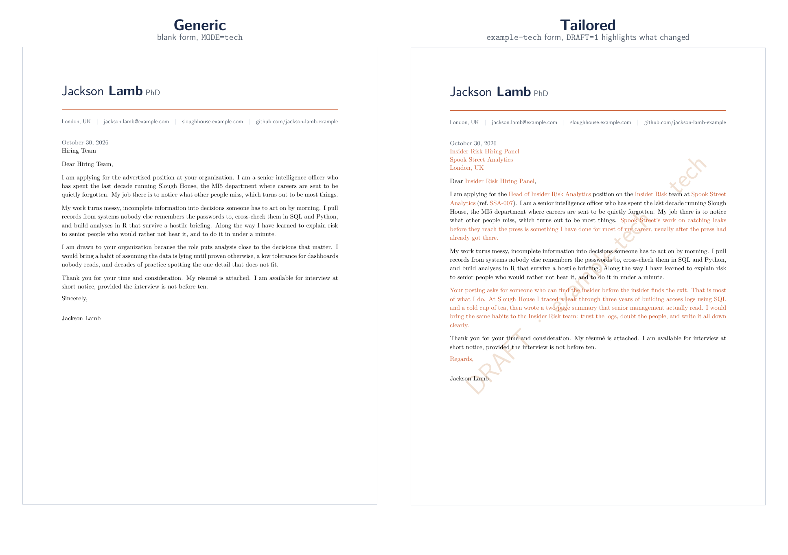

# LaTeX Application Kit

[](LICENSE)


> **Licensing:** [MIT](LICENSE). Copy it, change it, use it for your own applications.

A modular LaTeX system for job applications in **tech or academia**. You fill in **one form per job**,
and every document for that job builds from it with one command: the cover letter, the research,
teaching, diversity and service statements, the writing samples, and a combined application packet
that can also include your resume or CV.

I built the original version while applying for academic, research and tech jobs at the same
time. Rewriting a whole letter for each application was slow and error-prone. My partner had
written a simpler version: a cover letter with a few modes and the employer details filled in
from one file. I took that and built it into a full system: my research and teaching statements
and writing samples read the same file, optional details appear or disappear depending on what
you fill in, any paragraph can be replaced for a single job, and everything merges into one
application packet. This repo is that system with a made-up applicant so you can see how it works
and start your own. The applicant is Jackson Lamb, head of Slough House: if you've watched
*Slow Horses*, read the examples closely.



*Left: the generic letter, built from the blank form. Right: the same source built from a filled-in
form. Draft mode (`DRAFT=1`) prints everything that came from the form in orange so you can proofread
exactly what was tailored.*

---

## What one form controls

Each job gets one file in `applications/`. Every document reads it, so the employer's name, the
position and any tailored paragraph are typed **once** and appear everywhere they should.

| Document | What the form changes |
| --- | --- |
| **Cover letter** | Employer, position, team, department, job reference, addressee, greeting, sign-off, date, a one-line hook, and any of the four paragraphs |
| **Research statement** | The line under the title (position, department, employer). Future Directions lists three generic items you write once; fill in one field in the form and a fourth item tailored to that job is added, and the sentence before the list changes from "three parts" to "four parts" by itself |
| **Teaching statement** | The same line under the title; the title the ad asks for (Teaching Statement / Teaching Philosophy / ...); a job-specific courses paragraph that replaces the generic one |
| **Diversity statement** | Written once and sent as is. The form sets only the line under the title and, if the ad uses a different name, the title (e.g. Statement of Contributions to Diversity, Equity and Inclusion) |
| **Service statement** | Written once and sent as is. The form sets only the line under the title |
| **Writing samples** | Which samples (up to three), their citations, and an intro line; builds a cover page with a clickable contents list |
| **Application packet** | Which documents go into one merged PDF, with bookmarks, for portals that take a single upload; your resume (tech) or CV (academia) is linked from the form and added with a yes/no switch |

Anything you leave empty disappears cleanly. No "at ." or "on the team" with a missing name.

## The cover letter: modes and paragraphs

### What a mode is
A **mode** is a set of general paragraphs written for one kind of job. You pick the mode when you
build (`MODE=tech`), and the same form can be built in any mode. The kit comes with five:

| Mode | For | Default greeting |
| --- | --- | --- |
| `academia` | faculty and lecturer posts | Dear Members of the Search Committee, |
| `postdoc` | postdoctoral and research fellow posts | Dear Members of the Selection Committee, |
| `tech` | industry roles | Dear Hiring Team, |
| `consulting` | consulting and analytics firms | Dear Recruiting Team, |
| `intorg` | international organizations and NGOs | Dear Recruitment Panel, |

Research, teaching, diversity and service statements are there for academic applications; a tech
application simply switches them off in the form.

### What is inside each mode
Each mode is a folder in `cover_letter/modes/` with the same five files. The letter is always built
in this order: letterhead, date, address block, greeting, then the four paragraphs, then the sign-off.

| File | What it holds |
| --- | --- |
| `settings.tex` | who the letter greets by default (e.g. `Hiring Team`) |
| `intro.tex` | the opening: the role, who you are in one sentence, and the job's one-line hook |
| `skills.tex` | your evidence: the two or three things you have done that matter most for this kind of job |
| `fit.tex` | why this employer, and what you would do there |
| `conclusion.tex` | what is enclosed, and a short closing line |

### Step 1: draft a general version for each mode you need
Start by writing the four paragraphs for the modes you will actually use. You don't need all five:
someone applying only to industry jobs can write `tech` and `consulting` and ignore the rest. Write
each paragraph so it works for **any** employer of that kind, and wherever a job detail belongs (the
position, the employer's name, the team), use one of these macros instead of typing it:

| Write this | It prints | When the field is empty |
| --- | --- | --- |
| `\theposition` | the position, e.g. `Lecturer in History` | `advertised` |
| `\theemployer` | the company, or the university if there is no company | `your organization` |
| `\theshortname` | a short name for second mentions, e.g. `Westacre` | the full employer name |
| `\maybeteam` | ` on the Insider Risk team` | nothing |
| `\maybedept` | ` in the Department of History` | nothing |
| `\maybeschool` | ` in the School of Public Policy` | nothing |
| `\maybeproject` | ` on the Cold Files project` | nothing |
| `\maybespecialization` | ` with a focus on Cold War history` | nothing |
| `\maybejobref` | ` (ref. WU-1121)` | nothing |
| `\maybeappsentence` | the job's one-line hook from the form | nothing |

Three rules make them read correctly:

1. **No space before a `\maybe...` macro.** Each one brings its own leading space, so write
   `position\maybeteam` and not `position \maybeteam`.
2. **Put `\ ` (backslash and space) after `\theposition`, `\theemployer` and `\theshortname` when a
   word follows**, or LaTeX swallows the space: `the \theposition\ position`.
3. **For a whole sentence that depends on a field**, use `\ifempty{\field}{if empty}{if filled}`.
   The `academia` fit paragraph does this with `\deptfocus`, and `postdoc` with `\project`.

Put together, one sentence covers every case:

```latex
I am applying for the \theposition\ position\maybeteam\ at \theemployer\maybejobref.
```

| Form | Result |
| --- | --- |
| everything filled | I am applying for the Head of Insider Risk Analytics position on the Insider Risk team at Spook Street Analytics (ref. SSA-007). |
| no team, no job ref | I am applying for the Head of Insider Risk Analytics position at Spook Street Analytics. |
| blank form | I am applying for the advertised position at your organization. |

Build the blank form in your mode (`make letter APP=_blank_form MODE=tech`) to read your general
paragraphs on their own: if they make sense with every field empty, they will make sense for any job.

### Step 2: tailor any paragraph for one job, in the form
Most jobs only need the form's employer details and the one-line hook. When a job deserves more,
replace any or all of the four paragraphs **for that application only**, in section 5 of its form:

```latex
\newcommand{\individualizedintro}{}       % empty -> modes/<mode>/intro.tex
\newcommand{\individualizedskills}{}      % empty -> modes/<mode>/skills.tex
\newcommand{\individualizedfit}{Your posting asks for someone who ...}   % replaces fit.tex
\newcommand{\individualizedconclusion}{}  % empty -> modes/<mode>/conclusion.tex
```

A filled slot replaces that paragraph; an empty one falls back to the mode's general version. Your
general paragraphs are never edited, so the next application starts from them again. The tech
example tailors only its fit paragraph; the university example tailors none. Build with `DRAFT=1`
to see exactly which text came from the form.

---

## Quick start

**You need:** a TeX distribution with XeLaTeX and `latexmk`
([TeX Live](https://tug.org/texlive/), [MacTeX](https://tug.org/mactex/) or
[MiKTeX](https://miktex.org/)) and `make` (already on macOS and Linux).

```bash
git clone https://github.com/leeannvidal/latex-application-kit.git
cd latex-application-kit

make all APP=example-uni MODE=academia     # academic example: letter, CV, 4 statements, samples + packet
make all APP=example-tech MODE=tech        # tech example: letter, resume + packet
make letter APP=example-tech MODE=tech     # just the letter
```

PDFs land in `output/<APP>/`. That folder is created by your first build, so it isn't there in a
fresh copy, and `.gitignore` keeps it (and the `build/` scratch folder) out of git so your
personal PDFs never get committed by accident.

- `APP` is the form to use: the file name in `applications/`, without `.tex`.
- `MODE` is the cover-letter style (see the table above). It only affects the letter.
- Add `DRAFT=1` to any command for a proofreading copy.

| Command | Builds |
| --- | --- |
| `make all` | every document switched on in the form, then the combined packet |
| `make letter` | cover letter |
| `make research` / `teaching` / `diversity` / `service` | one statement |
| `make statements` | all four statements |
| `make samples` | writing samples |
| `make new APP=<name>` | a new form, copied from the blank one |
| `make list` | the forms and modes you have |
| `make clean` | deletes `build/` (keeps your PDFs) |
| `make distclean` | deletes `build/` and `output/`, including your PDFs |
| `make help` | prints all of the above |

## Make your own in 5 minutes

1. **Put in your details once.** Open `shared/applicant.tex` and replace Jackson Lamb's name, email and
   links with yours. Set `PREFIX` near the top of the `Makefile` to your surname
   (files come out as `Yourname_Cover_Letter.pdf`).
2. **Write your general paragraphs once.** For each mode you need, replace the four paragraphs in
   `cover_letter/modes/<mode>/` (`intro`, `skills`, `fit`, `conclusion`) with your own, using the
   field macros where job details go. See [Step 1](#step-1-draft-a-general-version-for-each-mode-you-need)
   above for the macros and the three rules.
   If you apply to academic jobs, do the same for the four statements in `statements/`.
3. **Start a form for a job.**
   ```bash
   make new APP=spook-street-insider-risk
   ```
   This copies `applications/_blank_form.tex`. Every field in it is explained in place.

   **Choose the form name with care.** It becomes the `APP=` you type and the name of the folder
   your PDFs land in (`output/<name>/`), so pick one you'll recognize months later. Use lowercase
   words joined by hyphens, no spaces, naming the employer and the role: `spook-street-insider-risk`,
   `westacre-lecturer-security`. Avoid private notes like `long-shot` or `backup-job`.
4. **Fill in what you know** and leave the rest empty. If the job wants writing samples, list them
   in section 8. In section 9, switch on (`yes`) the documents this job asks for, and point
   `\resumefile` and/or `\cvfile` at your own PDFs. Then build:
   ```bash
   make all APP=spook-street-insider-risk MODE=tech DRAFT=1   # proofread: tailored text in orange
   make all APP=spook-street-insider-risk MODE=tech           # final
   ```
5. **Next job?** `make new APP=next-job`. Your general paragraphs are already written, so each new
   application is one short form, plus any paragraph you choose to tailor.

---

## How it works

### Two axes
The cover letter is built from two independent choices:

- **Mode** (`MODE=tech`) picks the folder of general paragraphs: `cover_letter/modes/tech/`.
- **Application** (`APP=example-tech`) picks the form: `applications/example-tech.tex`.

Any mode works with any form, so the same job can be tried as `postdoc` and as `academia` with no
edits. To add a mode, copy a folder in `cover_letter/modes/`, rewrite its five files, and build with
`MODE=<new folder name>`. The empty-field macros all live in `shared/macros.tex`.

### Which documents get built
Section 9 of the form has a yes/no switch for each document:

```latex
\newcommand{\packetletter}{yes}
\newcommand{\packetresume}{yes}   % tech jobs usually want a resume
\newcommand{\packetcv}{no}        % academic jobs usually want a CV
\newcommand{\packetresearch}{no}
...
```

`make all` builds every document marked `yes` and then merges them, in a fixed order with a PDF
bookmark for each, into one packet (`Lamb_Application_Packet.pdf`, with your surname in front) for
portals that take a single upload. Each form gets its own folder, so packets for different jobs
never overwrite each other. The separate PDFs stay in the same `output/<APP>/` folder for portals
that want one file per document. The kit doesn't build resumes or CVs, so the form takes a path to
each (`\resumefile`, `\cvfile`); the examples point at placeholders in `sample_files/`.

### Draft mode
Add `DRAFT=1` to any command. Every piece of text that came from the form prints in the accent color,
and a watermark names the form (and, on letters, the mode), so you can check a document before it
goes out. Draft copies are for you: build again without `DRAFT=1` before you send anything.

### How the build passes the choices to LaTeX
For each document, the `Makefile` writes a temporary one-line wrapper next to the source (deleted
after the build), for example

```latex
\def\letterfile{example-tech}\def\covermode{tech}\input{cover_letter}
```

and compiles that with `latexmk -xelatex`. Each document also has a `\providecommand` default for
`\letterfile` (and the letter for `\covermode`), so it compiles on its own in an editor (see
[Building without make](#building-without-make)).

---

## Structure

```text
├── README.md
├── LICENSE                  # MIT
├── Makefile                 # all build commands (make help)
├── applications/            # ONE FORM PER JOB
│   ├── _blank_form.tex      #   empty form, every field explained
│   ├── example-tech.tex     #   fictional company, tech mode
│   └── example-uni.tex      #   fictional university, every academic document
├── shared/
│   ├── header.tex           # layout, fonts, COLORS, headings, letterhead
│   ├── applicant.tex        # your name and contact details (fill in once)
│   └── macros.tex           # empty-field macros, paragraph overrides, draft mode
├── cover_letter/
│   ├── cover_letter.tex     # the letter: letterhead, address, 4 paragraph slots, sign-off
│   ├── letter_parts.tex     # address block, greeting, sign-off
│   ├── mode.tex             # MODE -> modes/<mode>/
│   └── modes/               # academia, postdoc, tech, consulting, intorg
│       └── <mode>/          #   settings, intro, skills, fit, conclusion
├── statements/
│   ├── research_statement.tex
│   ├── teaching_statement.tex
│   ├── diversity_statement.tex
│   └── service_statement.tex
├── writing_samples/
│   └── writing_samples.tex  # cover page + contents + up to 3 PDFs
├── packet/
│   └── application_packet.tex  # merges the built PDFs into one
├── sample_files/            # placeholder resume, CV and writing samples (replace with yours)
└── examples/                # built example PDFs and the README image
```

## Make it look like yours

**Colors.** All documents use five named colors, `color1` to `color5`, defined in one block in
`shared/header.tex`. The comments there say what each one controls (name and headings, accent,
secondary text, rules, watermark) and show how to enter HEX or RGB values. The default is navy and
burnt orange, with two more palettes (crimson and charcoal, plum and gold) ready to uncomment.

**Font.** The kit uses Libertinus, which comes with TeX Live and MiKTeX (if it is missing, the
build falls back to Latin Modern instead of failing). Swap it in the "Engine & fonts" section of
`shared/header.tex`.

**Paper size and margins.** One line in the "Page layout" section; an A4 line is ready to uncomment.

## Building without make

Windows without `make`, or prefer TeXShop, TeXstudio or VS Code? Every document compiles on its
own. Open it, change the default near the top, and compile with **XeLaTeX** from the document's
own folder (the documents find `shared/` and `applications/` through `../`):

```latex
\providecommand{\letterfile}{example-tech}   % your form, without .tex
\providecommand{\covermode}{tech}            % cover letter only
```

The packet is the one exception: it merges PDFs from `output/<APP>/`, so build the other documents
first (with `make`), or merge your PDFs some other way.

## License

[MIT](LICENSE). Free to use, change and share, including for your own job applications.

The example applicant, Jackson Lamb, is a fictional character from Mick Herron's Slough House
novels and the TV series *Slow Horses*, used affectionately as sample content. The employers,
publications and paragraphs are made up, and the statements are mostly lorem ipsum. This project
has no connection to the books, the series or their publishers.
